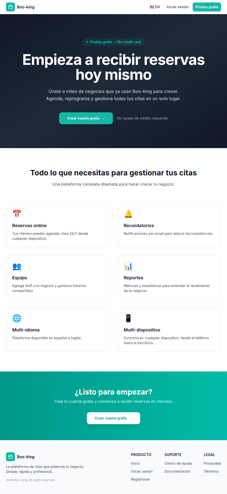
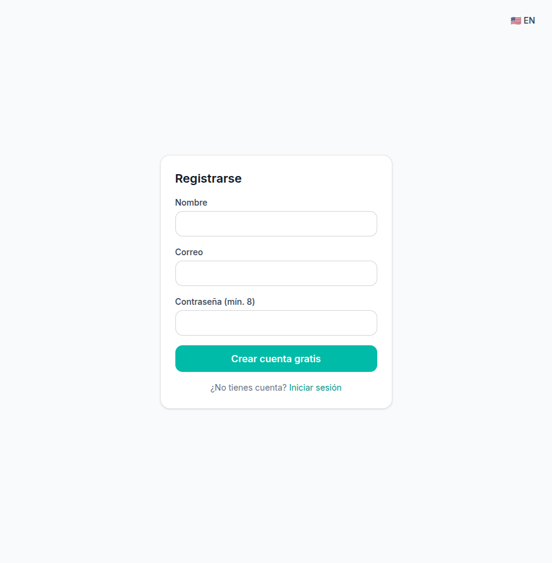
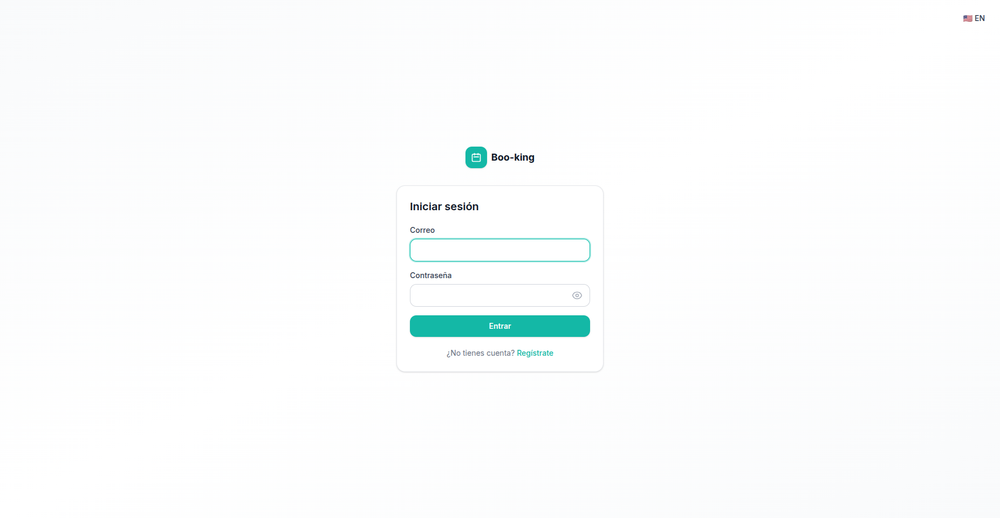
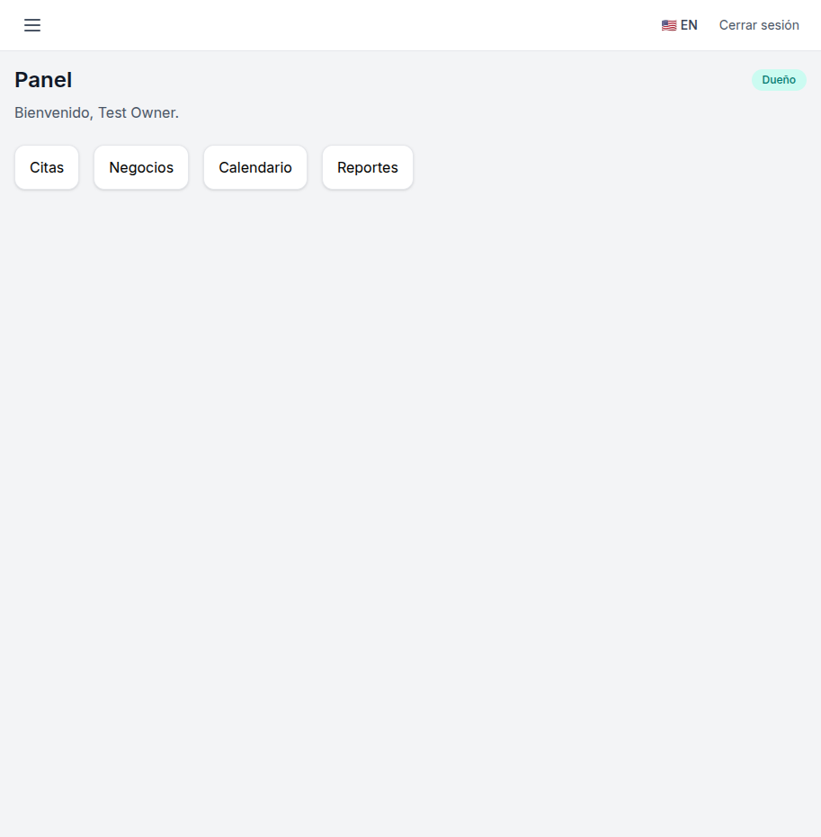
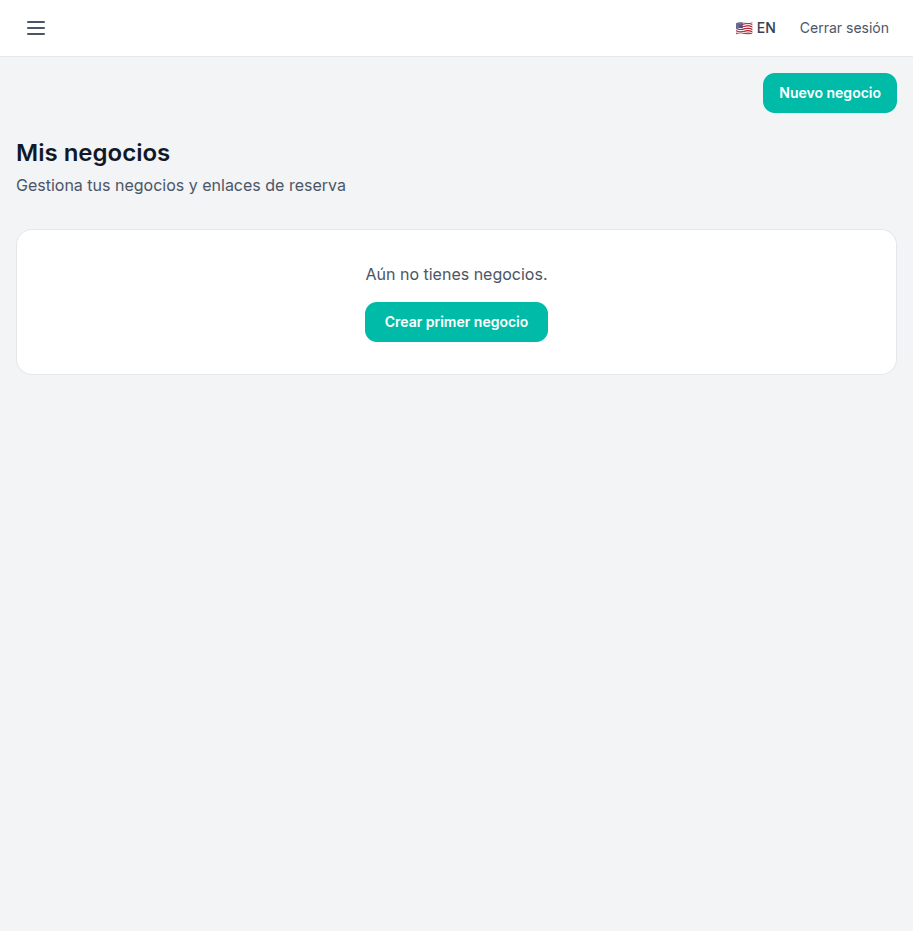
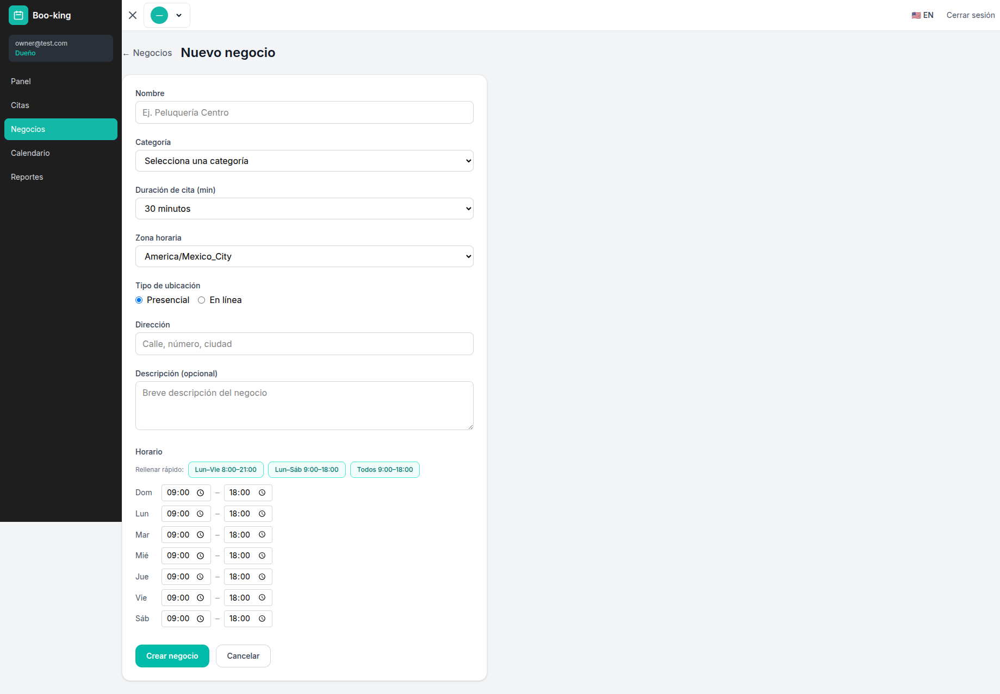
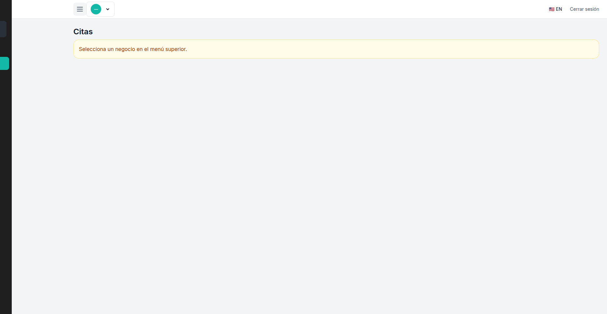
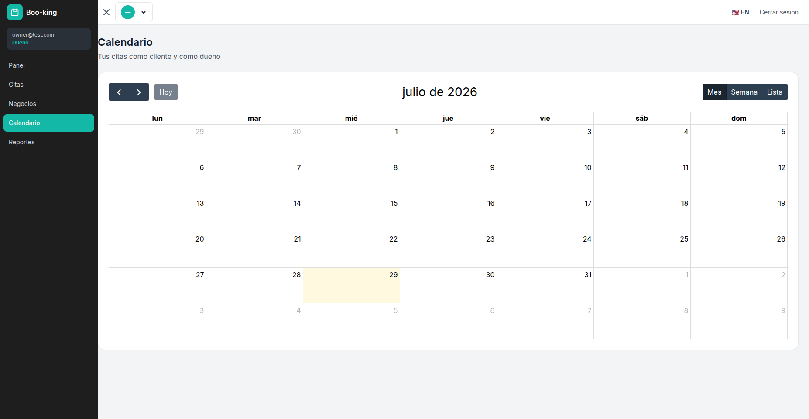
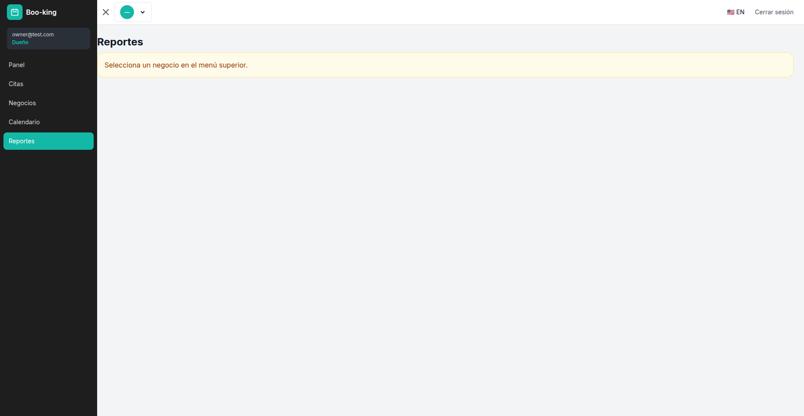
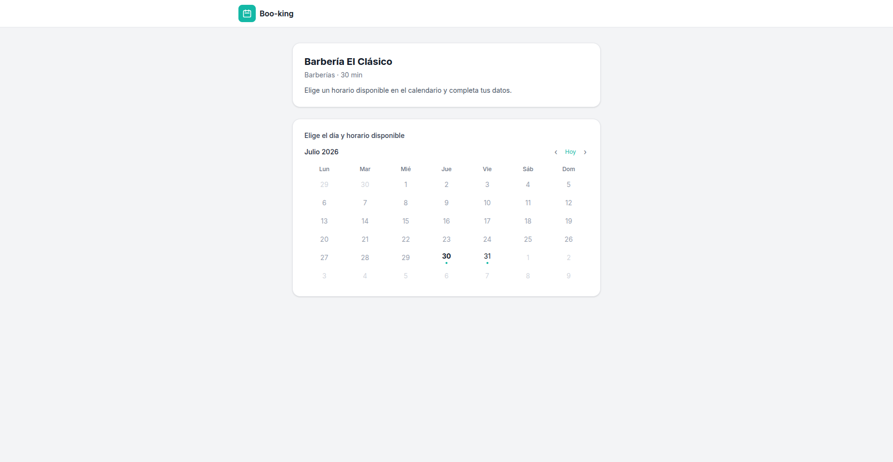

# 📅 Boo-king — Smart Appointment Booking System

A full-stack appointment scheduling platform that lets businesses manage their availability and clients book appointments online. Built with **Node.js (Express + Prisma)** and **React (Vite + Tailwind CSS v4)**.

---

## Screenshots

| Landing Page | Register | Login |
|---|---|---|
|  |  |  |

| Dashboard | Business List | Business Form |
|---|---|---|
|  |  |  |

| Appointments | Calendar View | Reports |
|---|---|---|
|  |  |  |

| Public Booking Page |
|---|
|  |

---

## ✨ Features

- **Multi-business management** — Register and manage multiple businesses (barbershops, clinics, gyms, etc.) under a single account
- **Public booking flow** — Clients can browse available time slots and book appointments without signing up
- **Interactive calendar** — FullCalendar integration for daily/weekly/monthly views of all appointments
- **Smart scheduling** — Configurable duration (15, 30, 45, 60, 90, 120 min), custom weekly schedules per business
- **Appointment management** — View, confirm, cancel, and filter appointments by status
- **Location support** — In-person (with address display) and online (with meeting link) appointment types
- **Reports & analytics** — Dashboard with charts (Recharts) showing appointment trends, status breakdowns, and daily counts
- **Multi-language** — Built-in i18n with Spanish and English (extensible via i18next)
- **Staff management** — Add staff members to businesses with role-based access (Owner, Admin, Staff)
- **Responsive design** — Mobile-friendly sidebar, responsive layouts, PWA-ready
- **Secure auth** — JWT-based authentication with bcrypt password hashing

---

## 🧱 Tech Stack

### Backend (`/backend`)

| Layer | Technology |
|---|---|
| Runtime | Node.js 22 |
| Framework | Express 4 |
| ORM | Prisma 5 + SQLite |
| Auth | JWT (jsonwebtoken) + bcryptjs |
| Validation | express-validator |
| Email | Nodemailer |
| Google Auth | google-auth-library |

### Frontend (`/frontend`)

| Layer | Technology |
|---|---|
| Framework | React 19 |
| Bundler | Vite 7 |
| Styling | Tailwind CSS v4 |
| Routing | react-router-dom v7 |
| Calendar | FullCalendar 6 |
| Charts | Recharts |
| i18n | i18next + react-i18next |
| PWA | vite-plugin-pwa |

---

## 🚀 Running Locally

### Prerequisites

- Node.js >= 18
- npm

### 1. Backend

```bash
cd backend
cp .env.example .env
```

Edit `.env` and configure at least:

```
DATABASE_URL="file:./prisma/dev.db"
JWT_SECRET=your-secret-key
```

Then:

```bash
npm install
npx prisma db push
npm run db:seed
npm run dev
```

The API starts at **http://localhost:4000**.

### 2. Frontend (in a separate terminal)

```bash
cd frontend
npm install
npm run dev
```

The app runs at **http://localhost:3000** (Vite proxies `/api` requests to the backend).

---

## 🐳 Docker

### Development (two containers)

```bash
# Start backend + frontend in dev mode with hot reload
docker compose up --build -d

# Backend: http://localhost:4000
# Frontend: http://localhost:3002
```

The `docker-compose.yml` mounts the source directories so changes reflect instantly via `node --watch` and Vite HMR.

### Production (single container)

The root `Dockerfile` (multi-stage) builds frontend + backend into a single optimized image:

```bash
# Uses the "production" profile
docker compose --profile production up --build -d

# App: http://localhost:8080
```

**Note:** Port 3002 is used for the frontend to avoid conflicts with other projects using port 3000 on the same host.

---

## ☁️ Render Deployment

The project ships with a `render.yaml` Blueprint for one-click deployment on [Render](https://render.com) using SQLite with persistent disk.

1. Connect your GitHub repo to Render.
2. Render auto-detects `render.yaml` — create services via "New > Blueprint".
3. The root `Dockerfile` builds frontend + backend into a single container.
4. SQLite is stored on a persistent disk at `/app/data`.
5. `JWT_SECRET` is auto-generated; you can set it manually in the Dashboard.

**Note:** Persistent disk requires a paid plan (e.g. **Starter**). Without it, data is lost on every redeploy.

---

## 📁 Project Structure

```
mvp/
├── backend/
│   ├── prisma/
│   │   ├── schema.prisma    # Data model (User, Business, Appointment, etc.)
│   │   └── seed.js          # Category seeder
│   └── src/
│       ├── index.js          # Express app entry
│       ├── middleware/       # Auth middleware
│       ├── routes/           # API routes (auth, businesses, appointments, booking, calendar, etc.)
│       └── services/         # Business logic
├── frontend/
│   └── src/
│       ├── pages/            # App pages (Home, Dashboard, Booking, Businesses, Calendar, Reports, etc.)
│       ├── components/       # Reusable UI components
│       ├── context/          # AuthContext
│       ├── api/              # API client
│       ├── hooks/            # Custom hooks
│       └── i18n.js           # i18n configuration
├── screenshots/              # App screenshots
├── docker-compose.yml
├── Dockerfile
└── render.yaml
```

---

## 🔌 API Endpoints

| Method | Endpoint | Description |
|---|---|---|
| POST | `/api/auth/register` | Register a new user |
| POST | `/api/auth/login` | Login |
| GET | `/api/businesses` | List user's businesses |
| POST | `/api/businesses` | Create a business |
| PUT | `/api/businesses/:id` | Update business + schedule |
| GET | `/api/appointments` | List appointments (filterable) |
| PATCH | `/api/appointments/:id/status` | Update appointment status |
| GET | `/api/calendar/events` | Calendar events in date range |
| GET | `/api/reports/stats` | Appointment statistics |
| GET | `/api/booking/business/:slug` | Public: get business info |
| GET | `/api/booking/business/:slug/calendar-slots` | Public: available slots |
| POST | `/api/booking/business/:slug/reserve` | Public: book an appointment |

---

## 📊 Data Model

- **User** — account owners, admins, and staff
- **Business** — service locations with schedules and branding settings
- **BusinessSchedule** — weekly operating hours per business
- **BusinessStaff** — staff assignments with roles
- **Appointment** — bookings with guest info, status, and meeting links
- **Category** — business categories (e.g. Barbershop, Spa, Clinic)

---

## 📄 License

MIT
